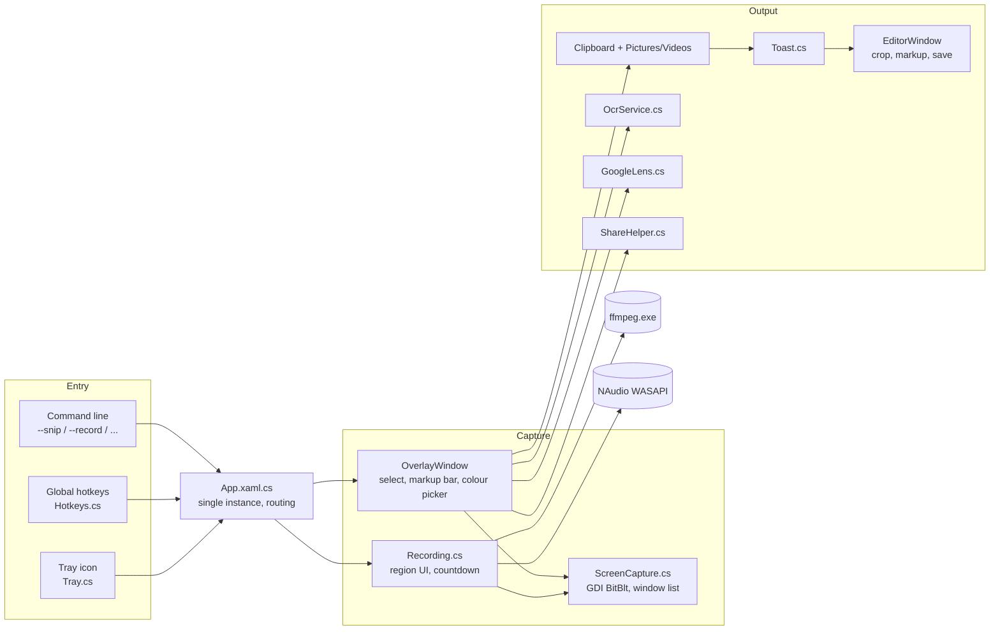
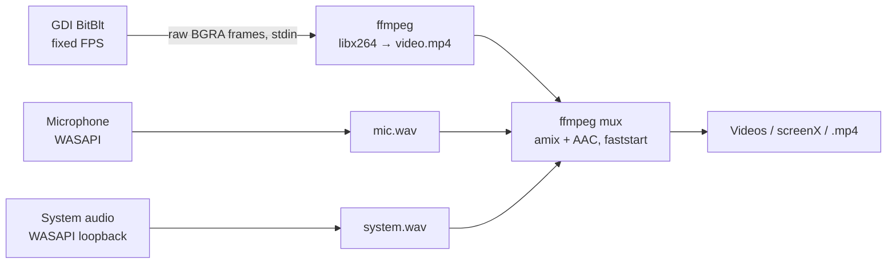

<div align="center">


# screenX

**Snip, mark up, record, pick colours and extract text on Windows, all from one shortcut.**

[](#requirements)
[](https://dotnet.microsoft.com/)
[](https://learn.microsoft.com/dotnet/desktop/wpf/)
[](LICENSE)

by [funwkwk](https://funwkwk.my.id)

</div>

screenX is an open-source screen capture tool for Windows. It works like the Windows Snipping Tool and adds
screen recording with audio, a colour picker, a text extractor (OCR), in-place markup with colour emoji and
Google Lens image search.

The source code is free software under the [GNU General Public License v3.0](LICENSE). Ready-to-install
builds are offered as a paid download on [funwkwk.my.id](https://funwkwk.my.id); buying one supports
development. You can always build screenX yourself from this source.

## Contents

- [Features](#features)
- [Usage](#usage)
- [Tech stack](#tech-stack)
- [Architecture](#architecture)
- [Project layout](#project-layout)
- [Build from source](#build-from-source)
- [Data and privacy](#data-and-privacy)
- [Third-party software](#third-party-software)
- [License](#license)

## Features

| | |
|---|---|
| **Snips** | Rectangle, window, full screen (all monitors) and freeform (transparent outside the shape) |
| **In-place markup** | Pen, highlighter, eraser, rectangle, ellipse, line, arrow, fill and outline, colour emoji you can move, resize and rotate, undo / redo |
| **Resizable selection** | Corner and edge handles stay active after the snip; mark-ups keep their place |
| **Editor** | Snipping Tool style window: crop, markup, save as PNG / JPG / BMP, copy, share, extract text, Edit in Paint |
| **Screen recording** | Any region to MP4 (H.264), optional microphone and system audio, 3-2-1 countdown, pause |
| **Colour picker** | Magnifier with pixel-exact arrow keys; HEX, RGB and HSL |
| **Text extractor** | Built-in Windows OCR in your profile languages |
| **Google Lens** | Opens Lens in your browser and pastes the snip for you |
| **Share** | The Windows share sheet |
| **Shortcuts** | Your own global shortcuts for snip and record, optional Print Screen key |
| **Installer** | The exe installs itself per user, no administrator rights needed |

Snips are copied to the clipboard and saved to `Pictures\screenX`; recordings go to `Videos\screenX`.

## Usage

Open screenX with **Ctrl + Shift + S** (change it in Settings). Windows keeps its own **Win + Shift + S**, so
both work side by side.

### Top toolbar

`[ snip | record ]  [ snip mode ▾ ]  [ quick markup ]  |  [ colour picker ]  [ text extractor ]  |  [ × ]`

| Mode | How | Result |
|---|---|---|
| Rectangle | Drag an area | Markup bar (when quick markup is on), otherwise copied and saved |
| Window | Hover a window and click | The whole window |
| Full screen | Pick it from the snip mode menu | All monitors |
| Freeform | Draw any shape | PNG, transparent outside the shape |
| Record | Drag an area, press **Start**, wait for the countdown | MP4 in `Videos\screenX`, file copied to the clipboard |
| Colour picker | Click a pixel (arrows = 1 px, Shift + arrows = 10 px, Enter = pick) | HEX copied; HEX, RGB and HSL from the notification |
| Text extractor | Drag over text | Text copied to the clipboard |

### Markup bar

`[ Capture ▾ ]  [ Share ]  [ Google Lens ]  |  [ Pen ] [ Highlighter ] [ Eraser ] [ Shapes ]  |  [ Undo ] [ Redo ]  |  [ Discard ]`

- **Capture ▾**: Capture (Ctrl + Enter), Save to (Ctrl + S), Copy only (Ctrl + C)
- Click the active pen or highlighter for **Colours** (30) and **Size**; click the active eraser for **Erase all**
- **Shapes** opens a second bar: emoji, rectangle, ellipse, line, arrow, **Fill** and **Outline**. Hold Shift for a square or circle
- Emoji can be moved, resized from the corners and rotated; Delete removes the selected one
- **Discard** or Esc closes the snip without saving; Ctrl + Z / Ctrl + Y undo and redo

Clicking the "Snip copied" notification opens the **editor**.

### Tray icon and command line

Left click the tray icon for a new snip; right click for full screen snip, screen record, colour picker, text
extractor, the screenshot and recording folders, **Settings** and Exit.

```text
screenX.exe --snip | --fullscreen | --record | --color | --text | --background
```

These also work while screenX is already running: the running copy picks up the command.

## Tech stack

| Layer | Technology |
|---|---|
| Language | C# with nullable reference types |
| Runtime | .NET 10 (`net10.0-windows10.0.19041.0`), published as one self-contained single-file exe |
| UI | WPF (XAML windows plus code-built windows), Windows Forms only for the tray icon |
| Screen capture | Win32 GDI `BitBlt` into a reusable top-down 32 bpp DIB, Per-Monitor-V2 DPI aware |
| Recording | GDI frames piped as raw BGRA into **FFmpeg** (`libx264`, CRF 20, `yuv420p`), then muxed with AAC audio |
| Audio | **NAudio** WASAPI: microphone capture and system loopback, mixed with FFmpeg `amix` |
| OCR | `Windows.Media.Ocr` (WinRT), the engine Snipping Tool and PowerToys use |
| Colour emoji | **Vortice.Direct2D1** (Direct2D + DirectWrite) for Segoe UI Emoji in colour |
| Share | WinRT `DataTransferManager` through `IDataTransferManagerInterop` |
| Hotkeys | `RegisterHotKey` on a message-only window |
| Storage | JSON settings in `%AppData%\screenX`; licence encrypted with DPAPI |
| Updates / licence | HTTPS JSON API, installer verified by SHA-256 before it runs |

## Architecture

screenX is a single-process tray app. One instance stays resident; each capture opens a full-screen overlay on
top of a frozen screenshot, and the result goes to the clipboard, disk, the editor or a toast.



### Startup and single instance

`App.xaml.cs` handles the special runs first (`--install`, `--uninstall`, `--selftest`, `--open <file>`), then
takes the named mutex `Local\screenX.SingleInstance`. A second copy does not start a UI: it signals a named
`EventWaitHandle` for the requested mode and exits, and the running copy opens that capture. The first copy
creates the tray icon, preloads the shutter sound, starts the update checks and registers the global hotkeys.
When a shortcut is taken by another app, a tray balloon says so instead of failing silently.

### Snip flow

1. `ScreenCapture` grabs the whole virtual screen in physical pixels.
2. `OverlayWindow` shows that frozen image across every monitor with the top toolbar. All selection maths is
   in physical pixels relative to the virtual screen, so mixed-DPI setups line up.
3. In window mode the overlay hit-tests the visible top-level windows in z-order.
4. With quick markup on, the markup bar opens under the selection; ink, shapes and emoji live on a WPF layer and
   are flattened onto the bitmap at the original pixel size when you capture.
5. The result is copied (`ClipboardUtil`), optionally saved, and announced with a `Toast`; clicking the toast
   opens `EditorWindow`.

screenX's own windows are excluded from captures with `SetWindowDisplayAffinity(WDA_EXCLUDEFROMCAPTURE)`.

### Recording pipeline



- Frames are captured on a timer and written to FFmpeg's stdin; the video is the master clock.
- Each audio track follows that clock: silence fills gaps (loopback is silent when nothing plays), audio that
  drifts ahead is dropped, and nothing is kept while paused. An unplugged device turns the rest of its track
  into silence instead of stopping the recording.
- After stop, FFmpeg copies the video stream and mixes the tracks into one AAC track (falling back for FFmpeg
  builds older than 4.4).
- FFmpeg is looked up on `PATH` or next to `screenX.exe`.

### Google Lens

`GoogleLens` copies the snip, opens Google's "Search any image with Google Lens" page in the default browser
and waits until that tab is in front. It then pastes the image into the page, so the upload happens inside the
browser's own session and the results page shows the image. If the browser tab is not in front, a toast tells
you to paste or drag the image yourself. Only window titles are logged, never image data.

### Installer, updates and licence

- **Installer**: the published single-file exe is its own setup. Named `screenX-Setup*.exe` (or run with
  `--install`) it copies itself to `%LocalAppData%\Programs\screenX`, creates shortcuts and registers in
  *Installed apps*. `--uninstall` reverses it. Everything is per user.
- **Updates**: `Updater` checks shortly after start and then every ~6 hours. A found update is downloaded at
  once, its SHA-256 is checked, and it is run only after you agree. Offline or server errors are silent.
- **Licence**: stored in `%AppData%\screenX\licence.json`, encrypted with Windows DPAPI for the current user. The
  device id is a SHA-256 of the machine GUID; the raw GUID never leaves the PC. Nothing secret is compiled into
  the app.

### Self-test

`screenX.exe --selftest <folder>` runs capture, OCR, colour maths, renders every window to PNG and makes a
2-second test recording, then writes `selftest.log`. `--selftest-licence` tests the licence storage against a
throw-away data folder.

## Project layout

| File | Responsibility |
|---|---|
| `App.xaml.cs` | Startup, command line, single instance, hotkey registration, capture routing |
| `OverlayWindow.xaml(.cs)` | Full-screen capture overlay, toolbar, markup bar, colour picker |
| `EditorWindow.xaml(.cs)` | Snipping Tool style editor |
| `Recording.cs` | Recording region UI, countdown, `RecordingSession` (GDI → FFmpeg), audio tracks, mux |
| `ScreenCapture.cs` | GDI capture, window enumeration, shutter sound |
| `Hotkeys.cs` | Global hotkeys and shortcut parsing |
| `Tray.cs` | Notification-area icon and menu |
| `SettingsWindow.cs`, `Settings.cs` | Settings UI and the JSON settings model |
| `OcrService.cs`, `TextResultWindow.cs` | Windows OCR and the result window |
| `GoogleLens.cs`, `ShareHelper.cs` | Lens search and the Windows share sheet |
| `EmojiRenderer.cs` | Colour emoji through Direct2D |
| `Toast.cs` | Bottom-right notification card |
| `Installer.cs`, `Updater.cs`, `Licence.cs` | Per-user install, signed updates, licence activation |
| `Native.cs`, `Util.cs` | Win32 P/Invoke, image and clipboard helpers |
| `SelfTest.cs`, `LicenceSelfTest.cs` | Automated self-tests |
| `Assets/` | App and tray icons, shutter sound |
| `build-installer.ps1` | Builds `dist\screenX-Setup-<version>.exe` |
| `tools/make_tray_icons.py` | Regenerates the tray icon sizes |

## Build from source

### Requirements

- Windows 10 version 2004 (build 19041) or later, or Windows 11
- [.NET 10 SDK](https://dotnet.microsoft.com/download)
- [FFmpeg](https://ffmpeg.org/) for screen recording only: `winget install Gyan.FFmpeg`, or put `ffmpeg.exe`
  next to `screenX.exe`

### Build and run

```powershell
dotnet build -c Release
```

```powershell
.\bin\Release\net10.0-windows10.0.19041.0\screenX.exe
```

### Installer

```powershell
powershell -ExecutionPolicy Bypass -File build-installer.ps1
```

This produces `dist\screenX-Setup-<version>.exe`: one self-contained file that needs no .NET on the target PC.

## Data and privacy

| What | Where |
|---|---|
| Settings | `%AppData%\screenX\settings.json` |
| Licence (DPAPI encrypted) | `%AppData%\screenX\licence.json` |
| Google Lens log (window titles only) | `%AppData%\screenX\lens.log` |
| Snips | `Pictures\screenX` |
| Recordings | `Videos\screenX` |

OCR runs on your PC. Images leave the PC only when you choose Google Lens or Share.

## Third-party software

- [Vortice.Direct2D1](https://github.com/amerkoleci/Vortice.Windows) (MIT License) renders colour emoji with Direct2D.
- [NAudio](https://github.com/naudio/NAudio) (MIT License) records the microphone and system audio.
- [FFmpeg](https://ffmpeg.org/) is used for screen recording. It is **not** included in this repository; screenX
  runs the copy installed on the PC. FFmpeg is licensed under the LGPL or GPL depending on the build, so any
  installer that bundles `ffmpeg.exe` must follow the terms of that build's licence.

## License

Copyright (c) 2026 [funwkwk](https://funwkwk.my.id).

screenX is free software: you can redistribute it and/or modify it under the terms of the
[GNU General Public License, version 3](LICENSE), as published by the Free Software Foundation.
It is distributed in the hope that it will be useful, but WITHOUT ANY WARRANTY; without even the implied
warranty of MERCHANTABILITY or FITNESS FOR A PARTICULAR PURPOSE. See the licence for the details.
